# Homelab topology and flows

Address-free reference edition.

## Homelab / physical → virtual → service tree

```mermaid
flowchart LR
  n_tree_0["Internet"]
  n_tree_1["Home router<br/>Model not verified"]
  n_tree_2["LAN fabric / Netgear GS110TPv3<br/>g5: px10 / g6: px20 / g7: px30 cable"]
  n_tree_3["Home Wi-Fi / AP<br/>AP model not verified"]
  n_tree_4["Wipro bulb<br/>Tuya LAN / TCP 6668"]
  n_tree_5["Samsung AC<br/>Local DTLS / UDP 49154"]
  n_tree_6["Outdoor camera<br/>Network attachment type unverified"]
  n_tree_7["Your phone / workstation<br/>Client addresses vary"]
  n_tree_8["Tailscale<br/>All three hosts online; px30 maintenance"]
  n_tree_9["Cloudflare DNS<br/>DNS records / ACME DNS-01, not a tunnel"]
  n_tree_10["External model APIs<br/>Hermes: DeepSeek Flash / Codex fallback"]
  n_tree_11["GitHub / Homelab repository<br/>Declarative configuration"]
  n_tree_12["slate / GCP VM<br/>External, documented; no fresh health check"]
  n_tree_13["Caddy"]
  n_tree_14["Uptime Kuma"]
  n_tree_15["ntfy"]
  n_tree_16["px10 / Dell OptiPlex 5060<br/>i5-8400T / 6 cores / 32 GB / ZFS"]
  n_tree_17["VM 100 / dev"]
  n_tree_18["LXC 104 / observability"]
  n_tree_19["LXC 109 / store"]
  n_tree_20["LXC 102 / dns"]
  n_tree_21["LXC 103 / auth"]
  n_tree_22["LXC 105 / s3"]
  n_tree_23["VM 107 / haos"]
  n_tree_24["VM 201 / k8s-201"]
  n_tree_25["Local ZFS / rpool + data<br/>Guest OS / data volumes"]
  n_tree_26["px20 / Dell OptiPlex 5060<br/>i5-8400T / 6 cores / 32 GB / ZFS"]
  n_tree_27["VM 204 / ctr"]
  n_tree_28["VM 106 / orva"]
  n_tree_29["LXC 101 / proxy"]
  n_tree_30["VM 202 / k8s-202"]
  n_tree_31["Local ZFS / rpool + data<br/>Guest OS / data volumes"]
  n_tree_32["px30 / Dell OptiPlex 7040<br/>i5-6500TE / 4 cores / 16 GB / ZFS / maintenance"]
  n_tree_33["VM 203 / k8s-203 / stopped"]
  n_tree_34["Local ZFS / rpool + data<br/>Guest OS / data volumes"]
  n_tree_35["Crucial X9 Pro / 4 TB<br/>USB: AV + BACKUP"]
  n_tree_36["SSD / 256 GB<br/>USB: ISO images / imports"]
  n_tree_37["SMB / AV<br/>TCP 445"]
  n_tree_38["SMB / BACKUP<br/>TCP 445"]
  n_tree_39["SMB / ISO<br/>TCP 445"]
  n_tree_40["Coding &amp; personal agents"]
  n_tree_41["Codex"]
  n_tree_42["Claude Code"]
  n_tree_43["Hermes"]
  n_tree_44["OpenCode"]
  n_tree_45["Claude subscription bridge<br/>Loopback only / Agent SDK"]
  n_tree_46["Claude Code CLI / SDK<br/>Existing CLI-owned Claude Max login"]
  n_tree_47["Anthropic / Claude plan<br/>Existing CLI-owned subscription login"]
  n_tree_48["Herdr<br/>Terminal sessions"]
  n_tree_49["Caddy / HTTPS + PostgreSQL proxy"]
  n_tree_50["AdGuard Home"]
  n_tree_51["Unbound"]
  n_tree_52["Pocket ID / OIDC"]
  n_tree_53["Tinyauth / forward-auth"]
  n_tree_54["Beszel"]
  n_tree_55["Grafana"]
  n_tree_56["VictoriaMetrics"]
  n_tree_57["Uptime Kuma"]
  n_tree_58["PVE / node exporters"]
  n_tree_59["Cairn S3"]
  n_tree_60["RustFS S3"]
  n_tree_61["Home Assistant"]
  n_tree_62["Mosquitto / MQTT"]
  n_tree_63["Quick Share function<br/>Upload → temporary object / short URL"]
  n_tree_64["Docker engine<br/>Intel iGPU passed through to ctr"]
  n_tree_65["Media"]
  n_tree_66["jellyfin<br/>Docker-internal unless published"]
  n_tree_67["frigate<br/>Docker-internal unless published"]
  n_tree_68["qbittorrent<br/>Docker-internal unless published"]
  n_tree_69["motrix-server<br/>Docker-internal unless published"]
  n_tree_70["Immich stack"]
  n_tree_71["immich-server<br/>Docker-internal unless published"]
  n_tree_72["immich-machine-learning<br/>Docker-internal unless published"]
  n_tree_73["immich-postgres<br/>Docker-internal unless published"]
  n_tree_74["immich-redis<br/>Docker-internal unless published"]
  n_tree_75["Karakeep stack"]
  n_tree_76["karakeep<br/>Docker-internal unless published"]
  n_tree_77["karakeep-chrome<br/>Docker-internal unless published"]
  n_tree_78["karakeep-meilisearch<br/>Docker-internal unless published"]
  n_tree_79["Paperless stack"]
  n_tree_80["paperless<br/>Docker-internal unless published"]
  n_tree_81["paperless-valkey<br/>Docker-internal unless published"]
  n_tree_82["Automation stack"]
  n_tree_83["n8n<br/>Docker-internal unless published"]
  n_tree_84["n8n-db<br/>Docker-internal unless published"]
  n_tree_85["searxng<br/>Docker-internal unless published"]
  n_tree_86["sandbox-api<br/>Docker-internal unless published"]
  n_tree_87["sandbox-runner<br/>Docker-internal unless published"]
  n_tree_88["Shared memory stack"]
  n_tree_89["openviking<br/>Docker-internal unless published"]
  n_tree_90["openviking-ollama<br/>Docker-internal unless published"]
  n_tree_91["Applications &amp; management"]
  n_tree_92["nivra<br/>Docker-internal unless published"]
  n_tree_93["nivra-theking<br/>Docker-internal unless published"]
  n_tree_94["opencloud<br/>Docker-internal unless published"]
  n_tree_95["forgejo<br/>Docker-internal unless published"]
  n_tree_96["registry<br/>Docker-internal unless published"]
  n_tree_97["omni<br/>Docker-internal unless published"]
  n_tree_98["portainer<br/>Docker-internal unless published"]
  n_tree_99["watchtower<br/>Docker-internal unless published"]
  n_tree_100["gitea-mirror<br/>Restarting / not healthy"]
  n_tree_101["Kubernetes / logical cluster<br/>k8s-201 / 202 active; k8s-203 stopped"]
  n_tree_102["Cluster networking"]
  n_tree_103["Cilium<br/>Kubernetes Service"]
  n_tree_104["CoreDNS<br/>Kubernetes Service"]
  n_tree_105["Platform / GitOps"]
  n_tree_106["Argo CD<br/>Kubernetes Service"]
  n_tree_107["Headlamp<br/>Kubernetes Service"]
  n_tree_108["Homepage<br/>Kubernetes Service"]
  n_tree_109["metrics-server<br/>Kubernetes Service"]
  n_tree_110["vmagent<br/>Kubernetes Service"]
  n_tree_111["kube-state-metrics<br/>Kubernetes Service"]
  n_tree_112["Distributed block storage"]
  n_tree_113["Longhorn<br/>2 replicas per current volume"]
  n_tree_114["Supabase suite"]
  n_tree_115["Studio<br/>Kubernetes Service"]
  n_tree_116["Kong<br/>Kubernetes Service"]
  n_tree_117["Auth<br/>Kubernetes Service"]
  n_tree_118["REST<br/>Kubernetes Service"]
  n_tree_119["Realtime<br/>Kubernetes Service"]
  n_tree_120["Storage<br/>Kubernetes Service"]
  n_tree_121["imgproxy<br/>Kubernetes Service"]
  n_tree_122["pooler<br/>Kubernetes Service"]
  n_tree_123["meta<br/>Kubernetes Service"]
  n_tree_124["functions<br/>Kubernetes Service"]
  n_tree_125["analytics<br/>Kubernetes Service"]
  n_tree_126["CloudNativePG"]
  n_tree_127["PostgreSQL primary<br/>Streaming replication"]
  n_tree_128["PostgreSQL standby A<br/>Streaming replication"]
  n_tree_129["PostgreSQL standby B / pending<br/>Streaming replication"]
  n_tree_130["Longhorn data disk<br/>500 GiB / host-local ZFS"]
  n_tree_131["Longhorn data disk<br/>500 GiB / host-local ZFS"]
  n_tree_132["Longhorn data disk<br/>500 GiB / stopped; replicas evacuated"]
  n_tree_133["Frigate recordings<br/>ctr local /data/apps/frigate/media"]
  n_tree_0 --> n_tree_1
  n_tree_0 --> n_tree_8
  n_tree_0 --> n_tree_9
  n_tree_0 --> n_tree_10
  n_tree_0 --> n_tree_11
  n_tree_0 --> n_tree_12
  n_tree_0 --> n_tree_47
  n_tree_1 --> n_tree_2
  n_tree_1 --> n_tree_3
  n_tree_2 --> n_tree_6
  n_tree_2 --> n_tree_7
  n_tree_2 --> n_tree_16
  n_tree_2 --> n_tree_26
  n_tree_2 --> n_tree_32
  n_tree_2 --> n_tree_101
  n_tree_3 --> n_tree_4
  n_tree_3 --> n_tree_5
  n_tree_12 --> n_tree_13
  n_tree_12 --> n_tree_14
  n_tree_12 --> n_tree_15
  n_tree_16 --> n_tree_17
  n_tree_16 --> n_tree_18
  n_tree_16 --> n_tree_19
  n_tree_16 --> n_tree_20
  n_tree_16 --> n_tree_21
  n_tree_16 --> n_tree_22
  n_tree_16 --> n_tree_23
  n_tree_16 --> n_tree_24
  n_tree_16 --> n_tree_25
  n_tree_16 --> n_tree_35
  n_tree_16 --> n_tree_36
  n_tree_17 --> n_tree_40
  n_tree_17 --> n_tree_48
  n_tree_18 --> n_tree_54
  n_tree_18 --> n_tree_55
  n_tree_18 --> n_tree_56
  n_tree_18 --> n_tree_57
  n_tree_18 --> n_tree_58
  n_tree_19 --> n_tree_37
  n_tree_19 --> n_tree_38
  n_tree_19 --> n_tree_39
  n_tree_20 --> n_tree_50
  n_tree_21 --> n_tree_52
  n_tree_21 --> n_tree_53
  n_tree_22 --> n_tree_59
  n_tree_22 --> n_tree_60
  n_tree_23 --> n_tree_61
  n_tree_23 --> n_tree_62
  n_tree_24 --> n_tree_130
  n_tree_26 --> n_tree_27
  n_tree_26 --> n_tree_28
  n_tree_26 --> n_tree_29
  n_tree_26 --> n_tree_30
  n_tree_26 --> n_tree_31
  n_tree_27 --> n_tree_64
  n_tree_28 --> n_tree_63
  n_tree_29 --> n_tree_49
  n_tree_30 --> n_tree_131
  n_tree_32 --> n_tree_33
  n_tree_32 --> n_tree_34
  n_tree_33 --> n_tree_132
  n_tree_40 --> n_tree_41
  n_tree_40 --> n_tree_42
  n_tree_40 --> n_tree_43
  n_tree_40 --> n_tree_44
  n_tree_44 --> n_tree_45
  n_tree_45 --> n_tree_46
  n_tree_50 --> n_tree_51
  n_tree_64 --> n_tree_65
  n_tree_64 --> n_tree_70
  n_tree_64 --> n_tree_75
  n_tree_64 --> n_tree_79
  n_tree_64 --> n_tree_82
  n_tree_64 --> n_tree_88
  n_tree_64 --> n_tree_91
  n_tree_65 --> n_tree_66
  n_tree_65 --> n_tree_67
  n_tree_65 --> n_tree_68
  n_tree_65 --> n_tree_69
  n_tree_67 --> n_tree_133
  n_tree_70 --> n_tree_71
  n_tree_70 --> n_tree_72
  n_tree_70 --> n_tree_73
  n_tree_70 --> n_tree_74
  n_tree_75 --> n_tree_76
  n_tree_75 --> n_tree_77
  n_tree_75 --> n_tree_78
  n_tree_79 --> n_tree_80
  n_tree_79 --> n_tree_81
  n_tree_82 --> n_tree_83
  n_tree_82 --> n_tree_84
  n_tree_82 --> n_tree_85
  n_tree_82 --> n_tree_86
  n_tree_82 --> n_tree_87
  n_tree_88 --> n_tree_89
  n_tree_88 --> n_tree_90
  n_tree_91 --> n_tree_92
  n_tree_91 --> n_tree_93
  n_tree_91 --> n_tree_94
  n_tree_91 --> n_tree_95
  n_tree_91 --> n_tree_96
  n_tree_91 --> n_tree_97
  n_tree_91 --> n_tree_98
  n_tree_91 --> n_tree_99
  n_tree_91 --> n_tree_100
  n_tree_101 --> n_tree_102
  n_tree_101 --> n_tree_105
  n_tree_101 --> n_tree_112
  n_tree_101 --> n_tree_114
  n_tree_101 --> n_tree_126
  n_tree_102 --> n_tree_103
  n_tree_102 --> n_tree_104
  n_tree_105 --> n_tree_106
  n_tree_105 --> n_tree_107
  n_tree_105 --> n_tree_108
  n_tree_105 --> n_tree_109
  n_tree_105 --> n_tree_110
  n_tree_105 --> n_tree_111
  n_tree_112 --> n_tree_113
  n_tree_114 --> n_tree_115
  n_tree_114 --> n_tree_116
  n_tree_114 --> n_tree_117
  n_tree_114 --> n_tree_118
  n_tree_114 --> n_tree_119
  n_tree_114 --> n_tree_120
  n_tree_114 --> n_tree_121
  n_tree_114 --> n_tree_122
  n_tree_114 --> n_tree_123
  n_tree_114 --> n_tree_124
  n_tree_114 --> n_tree_125
  n_tree_126 --> n_tree_127
  n_tree_126 --> n_tree_128
  n_tree_126 --> n_tree_129
  classDef c_tree_0 fill:#e7eff8,stroke:#6c7f8c,color:#233647;
  class n_tree_0,n_tree_1,n_tree_2,n_tree_3,n_tree_12,n_tree_16,n_tree_25,n_tree_26,n_tree_31,n_tree_32,n_tree_34,n_tree_35,n_tree_36,n_tree_130,n_tree_131,n_tree_132 c_tree_0;
  classDef c_tree_1 fill:#fff3df,stroke:#6c7f8c,color:#233647;
  class n_tree_4,n_tree_5,n_tree_6,n_tree_7 c_tree_1;
  classDef c_tree_2 fill:#f0edf9,stroke:#6c7f8c,color:#233647;
  class n_tree_8,n_tree_9,n_tree_10,n_tree_11,n_tree_40,n_tree_46,n_tree_47,n_tree_64,n_tree_65,n_tree_70,n_tree_75,n_tree_79,n_tree_82,n_tree_88,n_tree_91,n_tree_101,n_tree_102,n_tree_105,n_tree_112,n_tree_114,n_tree_126 c_tree_2;
  classDef c_tree_3 fill:#ffffff,stroke:#6c7f8c,color:#233647;
  class n_tree_13,n_tree_14,n_tree_15,n_tree_37,n_tree_38,n_tree_39,n_tree_41,n_tree_42,n_tree_43,n_tree_44,n_tree_45,n_tree_48,n_tree_49,n_tree_50,n_tree_51,n_tree_52,n_tree_53,n_tree_54,n_tree_55,n_tree_56,n_tree_57,n_tree_58,n_tree_59,n_tree_60,n_tree_61,n_tree_62,n_tree_63,n_tree_66,n_tree_67,n_tree_68,n_tree_69,n_tree_71,n_tree_72,n_tree_73,n_tree_74,n_tree_76,n_tree_77,n_tree_78,n_tree_80,n_tree_81,n_tree_83,n_tree_84,n_tree_85,n_tree_86,n_tree_87,n_tree_89,n_tree_90,n_tree_92,n_tree_93,n_tree_94,n_tree_95,n_tree_96,n_tree_97,n_tree_98,n_tree_99,n_tree_100,n_tree_103,n_tree_104,n_tree_106,n_tree_107,n_tree_108,n_tree_109,n_tree_110,n_tree_111,n_tree_113,n_tree_115,n_tree_116,n_tree_117,n_tree_118,n_tree_119,n_tree_120,n_tree_121,n_tree_122,n_tree_123,n_tree_124,n_tree_125,n_tree_127,n_tree_128,n_tree_129,n_tree_133 c_tree_3;
  classDef c_tree_4 fill:#e8f4f0,stroke:#6c7f8c,color:#233647;
  class n_tree_17,n_tree_18,n_tree_19,n_tree_20,n_tree_21,n_tree_22,n_tree_23,n_tree_24,n_tree_27,n_tree_28,n_tree_29,n_tree_30,n_tree_33 c_tree_4;
```

## Camera / events to Home Assistant


## Bulb / local control


## AC / local control


## Media / downloads to playback

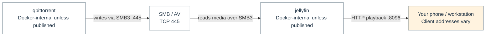

## Temporary sharing

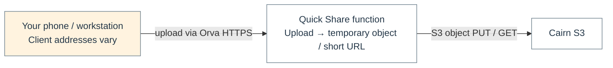

## Container registry

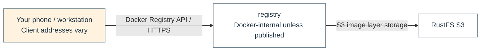

## Private browser access


## Camera / live video

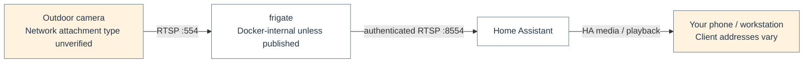

## Camera / recording storage

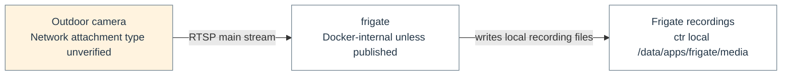

## Browser / application request


## DNS / name resolution


## Supabase / database API


## Store / physical media path

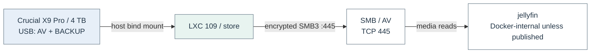

## GitOps / desired state

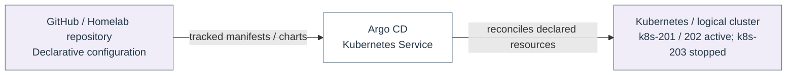

## Motrix / download to playback

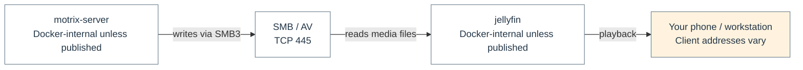

## OpenCode / Claude subscription


## Kubernetes / three VM members

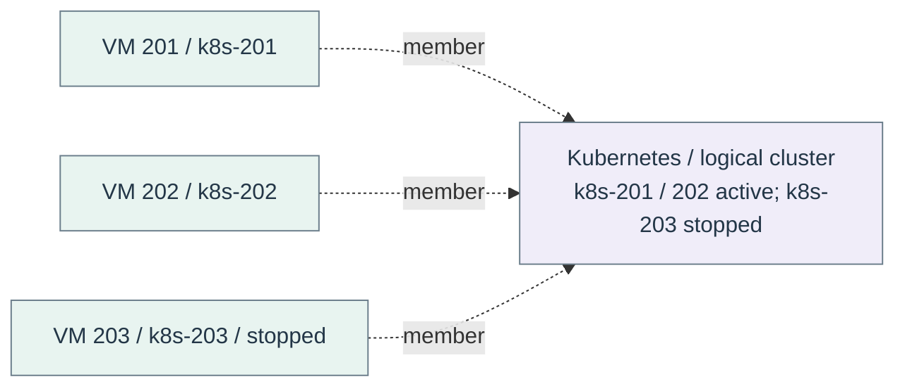

## Metrics / independent readers

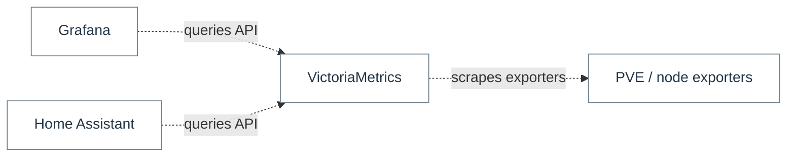

## Memory / independent local and external dependencies

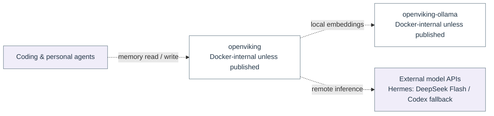

## Omni / Talos machine management

```mermaid
flowchart LR
  n_flow_16_0["omni<br/>Docker-internal unless published"]
  n_flow_16_1["VM 201 / k8s-201"]
  n_flow_16_2["VM 202 / k8s-202"]
  n_flow_16_3["VM 203 / k8s-203 / stopped"]
  n_flow_16_0 -.->|"machine management"| n_flow_16_1
  n_flow_16_0 -.->|"machine management"| n_flow_16_2
  n_flow_16_0 -.->|"machine management"| n_flow_16_3
  classDef c_flow_16_0 fill:#ffffff,stroke:#6c7f8c,color:#233647;
  class n_flow_16_0 c_flow_16_0;
  classDef c_flow_16_1 fill:#e8f4f0,stroke:#6c7f8c,color:#233647;
  class n_flow_16_1,n_flow_16_2,n_flow_16_3 c_flow_16_1;
```

## Longhorn / 2 replicas per volume, across eligible disks

```mermaid
flowchart LR
  n_flow_19_0["Longhorn<br/>2 replicas per current volume"]
  n_flow_19_1["Longhorn data disk<br/>500 GiB / host-local ZFS"]
  n_flow_19_2["Longhorn data disk<br/>500 GiB / host-local ZFS"]
  n_flow_19_3["Longhorn data disk<br/>500 GiB / stopped; replicas evacuated"]
  n_flow_19_0 -.->|"eligible disk"| n_flow_19_1
  n_flow_19_0 -.->|"eligible disk"| n_flow_19_2
  n_flow_19_0 -.->|"offline / no replicas"| n_flow_19_3
  classDef c_flow_19_0 fill:#ffffff,stroke:#6c7f8c,color:#233647;
  class n_flow_19_0 c_flow_19_0;
  classDef c_flow_19_1 fill:#e7eff8,stroke:#6c7f8c,color:#233647;
  class n_flow_19_1,n_flow_19_2,n_flow_19_3 c_flow_19_1;
```
